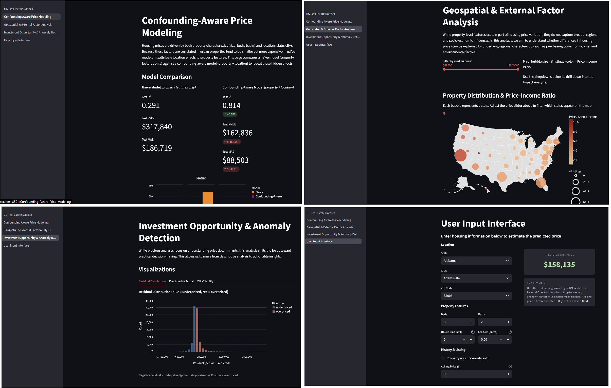

# US-RealEstate Insight: Multi-Dimensional Valuation & Investment Decision Support System

**CMU Interactive Data Science Final Project — Spring 2026**

---

## Team Members

| Name | Andrew ID | Role |
|---|---|---|
| Chyi-Jiunn Lin | chyijiul@andrew.cmu.edu | Page 1 — Confounding-Aware Price Modeling |
| Chenkai Liu | chenkai3@andrew.cmu.edu | Page 2 — Geospatial & External Factor Analysis |
| James Fu | jfu2@andrew.cmu.edu | Page 3 — Investment Opportunity & Anomaly Detection |
| Adrian Liu | adrianli@andrew.cmu.edu | Page 4 — User Input Interface & Integration |

---

## Summary Image



---

## Abstract

This project presents a multi-page Streamlit dashboard for U.S. real estate analysis. The main idea is that housing prices depend on both property level features, such as bedrooms, bathrooms, and square footage, as well as geographical context, such as city, state, and local market conditions. A model that ignores location can therefore misattribute part of the price signal to structural features alone.

The implemented dashboard compares a baseline price model with a confounding-aware model that includes location features, explores state level relationships between housing prices and income, and uses residuals to flag potentially underpriced or volatile markets. It also includes an interactive estimator that lets a user enter property attributes and receive a predicted fair price and also a simple investment recommendation.

The system is built around the USA Real Estate Dataset from Kaggle [1], authored by Ahmed Shahriar Sakib, and incorporates state level median household income values from the U.S. Census Bureau’s American Community Survey (ACS) [2].

---

## Link to Report

[Full project report](Report.md)

---

## Video Demonstration

[Video](https://drive.google.com/drive/folders/1chTo2TFI0nY9o0K2-vkMxvk1oJAo-rx_?usp=sharing)

---

## Application

The application runs locally via Streamlit (see **Running Instructions** below). There is no hosted public URL at this time.

---

## Running Instructions

### Prerequisites

```bash
pip install -r requirements.txt
```

The `requirements.txt` installs: `streamlit`, `pandas`, `numpy<2`, `pyarrow`, `scikit-learn`, `lightgbm`, `shap`, `matplotlib`, `altair`.

### Raw Data

Download the **USA Real Estate Dataset** CSV from [Kaggle](https://www.kaggle.com/datasets/ahmedshahriarsakib/usa-real-estate-dataset) and place it in /dataset/ (create if there isn't this folder).

### Build All Artifacts

Run the preprocessing and training scripts once in order. All outputs are cached in `artifacts/`.

```bash
python scripts/preprocess.py            # clean data, feature engineering, train/dev/test split
python scripts/train_page1.py           # train naive & aware LightGBM models, compute SHAP values
python scripts/preprocess_page2.py      # compute state- and city-level geospatial summaries
python scripts/compute_residuals_page3.py  # compute residuals on the test set
```

> All four scripts need to be run only once. Subsequent app launches read from the pre-built parquet and JSON artifacts directly.

### Launch the Dashboard

```bash
streamlit run "Project Overview.py"
```

Open the URL printed in your terminal. Use the sidebar to navigate between the four pages.

---

## Repository Structure

```
├── Project Overview.py       # Streamlit entry point
├── pages/
│   ├── 1_Confounding Aware Price Modeling.py
│   ├── 2_Geospatial & External Factor Analysis.py
│   ├── 3_Investment Opportunity & Anomaly Detection.py
│   └── 4_User Input Interface.py
├── dataset/
|   ├── realtor-data.zip.csv        # dataset downloaded
├── scripts/
│   ├── preprocess.py               # data cleaning & feature engineering
│   ├── preprocess_page2.py         # geospatial aggregations
│   ├── train_page1.py              # model training & SHAP
│   └── compute_residuals_page3.py  # residual computation
├── artifacts/
│   ├── data/                       # preprocessed parquet + encoders
│   ├── page1/                      # models, SHAP values, metrics
│   ├── page2/                      # state & city summaries
│   └── page3/                      # residuals
├── visualizations/                 # static screenshots used in report
├── Proposal.md
├── Report.md
└── requirements.txt
```

---

## Work Distribution

| Member | Contribution |
|---|---|
| **Chyi-Jiunn Lin** | Designed and implemented **Page 1** end-to-end. Defined the confounding analysis framing (naive vs. location-aware comparison), wrote the preprocessing and feature engineering pipeline (`scripts/preprocess.py`), trained both LightGBM models, computed SHAP values, and built the interactive Altair dependence plots and feature-importance shift table.|
| **Chenkai Liu** | Designed and implemented **Page 2**. Integrated ACS state-level median household income data, computed price-income ratios, built the interactive U.S. bubble map and city-level drill-down view, and wrote `scripts/preprocess_page2.py`. |
| **James Fu** |  Designed and implemented **Page 3**. Wrote `scripts/compute_residuals_page3.py` to generate residuals from the confounding-aware model, and developed the residual distribution, property screener, and ZIP-level opportunity/risk visualizations for identifying potentially underpriced and volatile markets. |
| **Adrian Liu** | Designed and implemented **Page 4**. Built the user-facing property input interface, integrated the trained model and encoders into a real-time estimator, implemented the buy/hold recommendation logic, and served as the overall integration coordinator ensuring UI consistency across all pages. Report draft.|

---

## Project Process Commentary

The project began with a concrete problem: buyers and investors struggle to determine whether a listing price is justified by the property itself or by its location and surrounding market conditions. We organized the work into four complementary analytical pillars — confounding analysis, geospatial affordability, anomaly detection, and an interactive estimator — and assigned each to one team member with a shared preprocessing foundation.

**What went well.** Restricting the modeling target to `status = "sold"` was a key early decision. It cut the dataset from 2.2 million rows to roughly 800,000 but ensured the target variable reflected actual transaction prices rather than listing aspirations. This made the confounding comparison credible. Pre-computing all model artifacts (SHAP values, residuals, aggregated summaries) and storing them as parquet files kept the Streamlit pages fast and avoided re-running expensive computations on every load.

**Challenges.** The ZIP-code-to-ZCTA mismatch for the ACS join was an anticipated pain point from the proposal. In practice, the direct join strategy worked well for the residential subset of the data, and the fallback crosswalk was not needed. A more persistent challenge was the high missingness in several key features (`bed`, `bath`, `house_size`, `acre_lot`) — up to 33% in some columns — which required careful grouped-median imputation and missing-indicator engineering to preserve usable signal without dropping large portions of the dataset.

**What we would do differently.** The ACS integration stopped at the state level. ZIP- or census-tract-level income data would let the geospatial and anomaly-detection pages work together more tightly. The buy/hold recommendation is currently a threshold rule; a full scoring system incorporating residual uncertainty and ZIP-level volatility would make Page 4 more defensible as a decision-support tool.

---

## Links to other papers and references

- [Project Proposal](Proposal.md) — problem statement, dataset description, methodology sketches, and TA feedback response
- [USA Real Estate Dataset on Kaggle](https://www.kaggle.com/datasets/ahmedshahriarsakib/usa-real-estate-dataset)
- [U.S. Census ACS](https://www.census.gov/programs-surveys/acs) — source of state-level median household income
