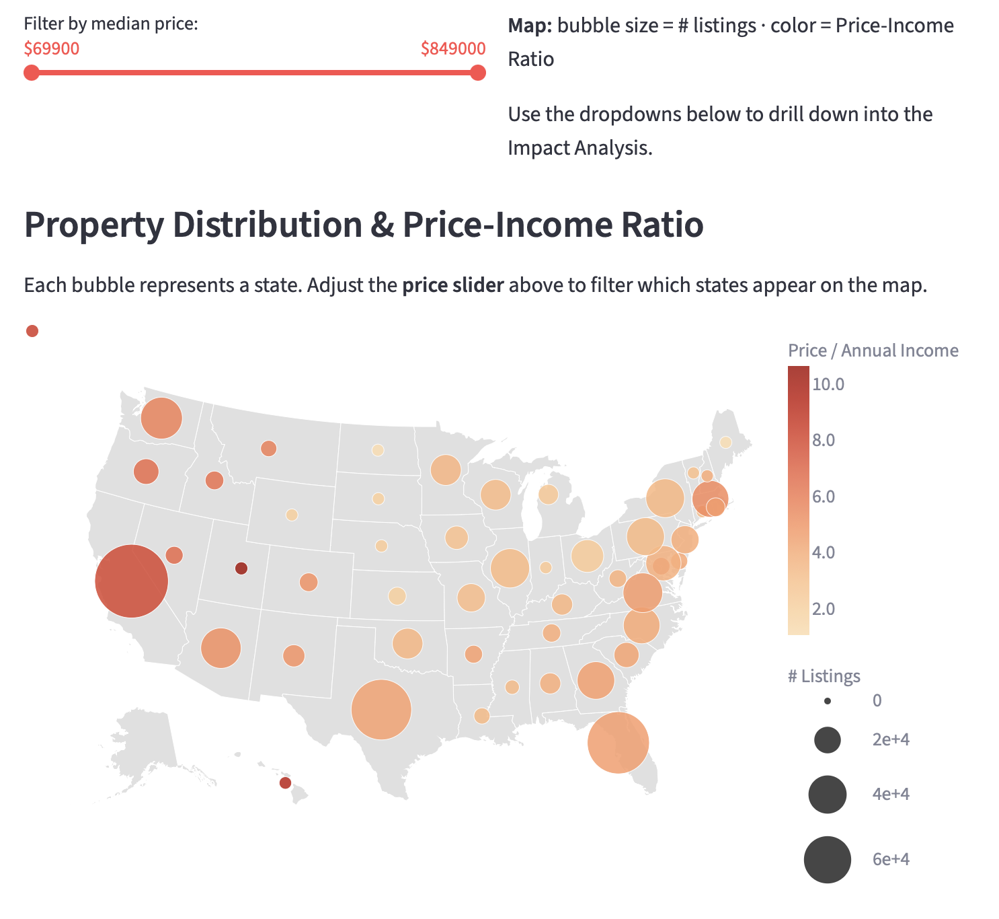
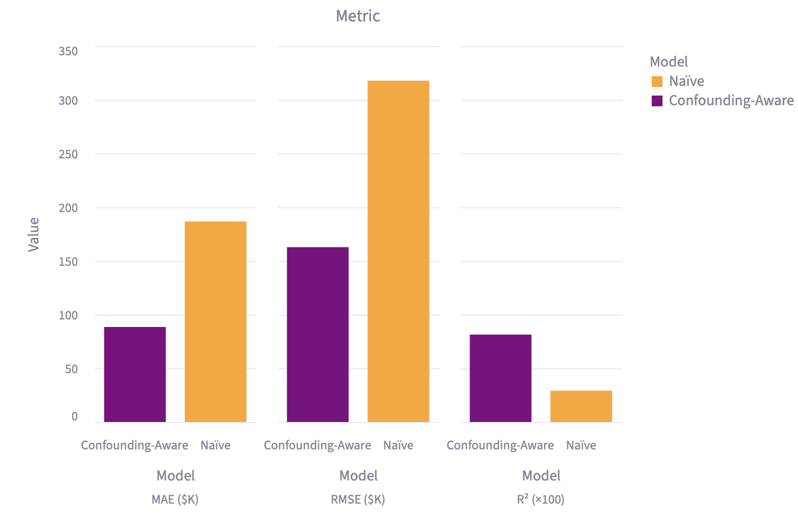
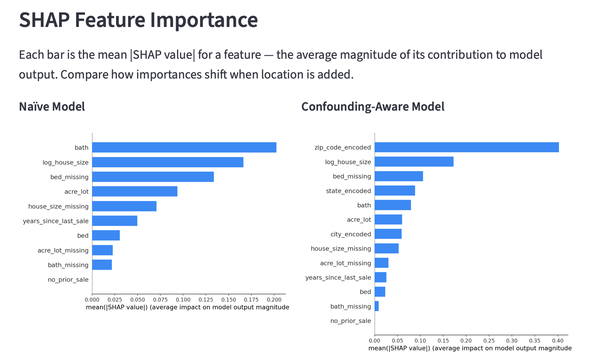
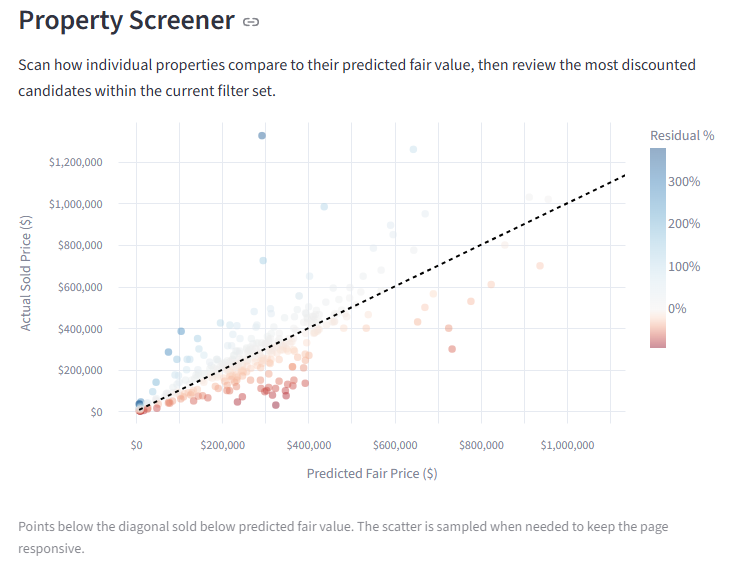
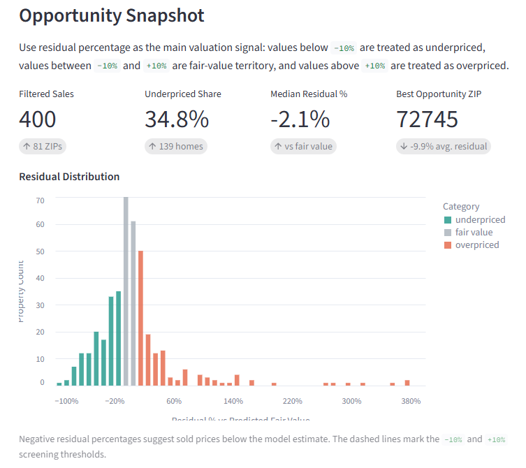
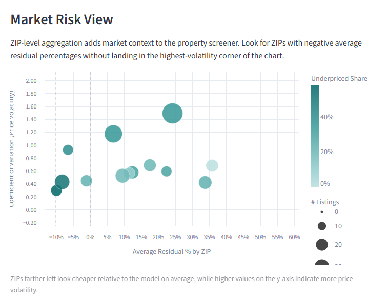

# Final Project Report

**Video URL**: https://drive.google.com/drive/folders/1chTo2TFI0nY9o0K2-vkMxvk1oJAo-rx_?usp=sharing

**Teaser Screenshot**: 

## Abstract

This project presents a multi-page Streamlit dashboard for U.S. real estate analysis. The main idea is that housing prices depend on both property level features, such as bedrooms, bathrooms, and square footage, as well as geographical context, such as city, state, and local market conditions. A model that ignores location can therefore misattribute part of the price signal to structural features alone.

The implemented dashboard compares a baseline price model with a confounding-aware model that includes location features, explores state level relationships between housing prices and income, and uses residuals to flag potentially underpriced or volatile markets. It also includes an interactive estimator that lets a user enter property attributes and receive a predicted fair price and also a simple investment recommendation.

The system is built around the USA Real Estate Dataset from Kaggle [1], authored by Ahmed Shahriar Sakib, and incorporates state level median household income values from the U.S. Census Bureau’s American Community Survey (ACS) [2].

## Introduction

Housing price analysis is a useful setting for studying confounding because prices are shaped by both the property itself in addition to the market around it. A large home might be expensive because of its size, but it could also be expensive because it is located in a high demand or a high income area. As a result, a model that only uses property level features like bedrooms, bathrooms, or square footage may overstate the importance of those features.

This project addresses this problem by comparing a baseline model with a confounding-aware model that includes location, doing geospatial and external factor analysis, and analyzing market volatility by zipcode. The goal is not only to predict price, but also to show how the interpretation changes when geographic information is added. The dashboard is organized into four pages: model comparison, geospatial analysis, anomaly detection, and a property input estimator.

## Related Work

Prior work on house price prediction often begins with structural characteristics of the home, such as square footage, number of bedrooms and bathrooms, lot size, and other property level attributes. These features are intuitive, widely available, and often provide strong predictive signal, which is why many traditional valuation models focus primarily on them. A key theoretical foundation for this line of work is Rosen's hedonic pricing framework, which formalizes the idea that prices reflect bundles of attributes rather than a single undifferentiated good [3]. In the housing setting, that framework implies that sale prices should be understood as a combination of structural features and locational or environmental characteristics.

More recent work has extended hedonic modeling with machine learning methods. Yoo, Im, and Wagner [4], for example, compared ordinary least squares with Cubist and Random Forest models for house sales in Onondaga County, New York, and showed that machine learning approaches can improve predictive performance while selecting different contextual and environmental variables. This line of work is especially relevant to our project because it highlights both the predictive value of non-structural information and the importance of variable selection in housing models.

Our project builds on this prior literature by using a property-only model as a baseline and then extending the analysis with geographic context through state, city, and ZIP code information. By comparing the baseline model with a confounding-aware model, the dashboard shows not only how predictive performance improves when location is included, but also how the interpretation of feature importance changes once market context is taken into account. In this way, the project connects the established literature on hedonic house price modeling with a broader framework that emphasizes context, interpretation, and decision support.

## Methods

The application uses the USA Real Estate Dataset as its primary source. The preprocessing pipeline filters to sold properties, removes obvious outliers, and handles missing values in important fields with median imputation and missing indicator variables. These steps preserve useful information that would be lost with simple row deletion. The pipeline also performs log transformation on price and house size, and creates new features for analysis such as price per square foot, years since last sale, and income price ratio. 

Location is represented through state, city, and ZIP code variables. The final feature set combines structure, time, and geography.

The model comparison page contrasts two regression setups. The naïve model uses only structural features, while the confounding-aware model adds location information. In the implementation, LightGBM is used as the prediction model because it performs well on tabular data and handles the engineered feature set effectively. SHAP summaries are used to visualize the changes in feature importance between the models by showing which variables matter most and how their importance changes once geography is included.

The geospatial page combines housing data with state level median household income values. It computes median price, mean price, price per square foot, and listing counts by state, then derives a price-income ratio as a rough affordability measure. The page includes a map and drill down views to allow users to compare states and cities for finer granularity.

The anomaly detection page turns residuals from the confounding-aware model into an investment screening dashboard. Residuals are calculated as actual price minus predicted price, and are also normalized by predicted price to support comparison across homes at different price levels. The page combines shared filters, residual-based KPI summaries, a predicted-versus-actual property screener, and a ZIP level opportunity-risk view that brings together average residuals, underpriced share, and price volatility. In this way, the page is designed not only to flag potentially underpriced properties, but also to place those opportunities in a broader market-risk context.

The input page turns the model into an interactive estimator. Users can enter location features such as state, city, ZIP code, as well as basic property features like bedrooms, bathrooms, and square footage, and the app will predict a fair price. If an asking price is provided, the page also gives a simple buy/hold recommendation based on whether that price is above or below the estimate.

## Results

The model comparison visualization is the clearest evidence that adding location improves the housing price model. The confounding-aware LightGBM model significantly outperforms the property features only baseline on test R², while also reducing RMSE and MAE. This result supports the original problem statement that price variation depends on both property features and geographic location.

The SHAP feature importance plot shows how the model’s explanation changes when location is included. In the naïve model, structural variables such as bathrooms, house size, lot size, and missingness indicators dominate. In the confounding-aware model, encoded ZIP and state features become more important, which suggests that geographic context absorbs a large part of the pricing signal.

The U.S. affordability map translates the model into a market level view. By plotting states with bubble size tied to listing count and color tied to price-income ratio, the visualization makes it easy to see where housing is expensive relative to local income. This helps answer the project’s broader question about how geography shapes affordability.

The predicted versus actual plot and residual histogram serve as the core of an investment screening workflow. The scatterplot compares predicted fair value against observed sale price for individual homes, making it easier to spot candidates that sold meaningfully below model expectations. The residual distribution complements this view by showing how the current filtered market is split among underpriced, fair-value, and overpriced properties. Together with the KPI snapshot above them, these visuals turn the model into a decision-support tool that helps users move from price estimation to opportunity identification.

The ZIP-level market view adds a broader layer of context by aggregating results at the ZIP code level. The view brings together average residual percentage, underpriced share, listing count, and price volatility so that users can compare opportunity against market risk. ZIP codes that appear relatively cheap on average but do not sit in the highest-volatility region of the chart are more compelling candidates for follow-up analysis. This makes the page more useful for investment-oriented interpretation because it connects individual underpriced properties to the stability of the surrounding market.

## Discussion

The project shows that real estate modeling is more informative when prediction and context are combined. A location free model can be useful, but it cannot fully explain price variation. Once geography is included, some of the signal that looked structural turns out to be contextual.

The dashboard is also stronger than a single model because it lets users move between levels of analysis. A user can inspect national patterns, state level affordability, property level prediction, and residual based screening in one place. That layered design fits real estate well, since the same home can be interpreted differently depending on the task.

The main takeaway is that the visuals work together as a pipeline: the comparison plot shows that geography matters, the SHAP plot shows how the model uses geography, and the residual and volatility views show where that model can be used for screening. The affordability map adds a broader market perspective that connects prediction to real world affordability, and the user input interface lets them see how location can affect housing prices.

## Future Work

A useful next step would be to add more localized socioeconomic variables, such as ZIP level or census tract level data, so the geographic analysis is more precise. The current ACS state level income layer is informative, but it does not capture all of the variation that may matter within a state.

The recommendation logic could also be expanded. Right now the app gives a simple buy/hold signal based on predicted versus asking price. That could be turned into a more complete scoring system that also accounts for uncertainty and market volatility. A more formal causal approach could also further strengthen the confounding analysis.

## References
[1] Ahmed Shahriar Sakib. USA Real Estate Dataset. Kaggle.
https://www.kaggle.com/datasets/ahmedshahriarsakib/usa-real-estate-dataset

[2] U.S. Census Bureau. American Community Survey (ACS).
https://www.census.gov/programs-surveys/acs

[3] Sherwin Rosen. Hedonic Prices and Implicit Markets: Product Differentiation in Pure Competition. Journal of Political Economy, 82(1):34-55, 1974.
https://doi.org/10.1086/260169

[4] Sanglim Yoo, Jungho Im, and John E. Wagner. Variable selection for hedonic model using machine learning approaches: A case study in Onondaga County, NY. Landscape and Urban Planning, 107(3):293-306, 2012.
https://doi.org/10.1016/j.landurbplan.2012.06.009
